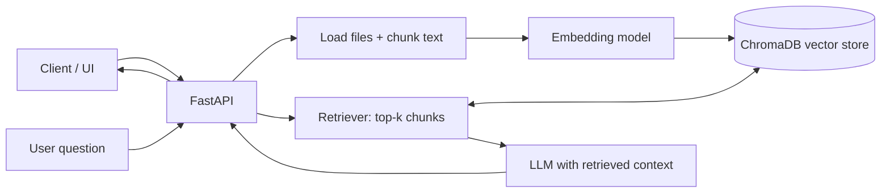

# Simple RAG Service

A small, GitHub-ready Retrieval-Augmented Generation (RAG) API built with **FastAPI + OpenAI + ChromaDB**. It ingests local `.txt`/`.md` files, retrieves relevant chunks, and answers questions grounded in those chunks.

## Architecture



**Minimum components**
1. **Document loader + chunker** — reads `.txt` and `.md` files and splits them into overlapping chunks.
2. **Embedding model** — converts text into vectors.
3. **Vector store** — persists vectors and metadata in local ChromaDB.
4. **Retriever** — finds the most relevant chunks for a question.
5. **LLM** — generates an answer from retrieved context.
6. **API** — exposes ingestion and question-answering endpoints.

## Folder structure

```text
simple-rag-service/
├── app/
│   ├── __init__.py
│   ├── main.py          # FastAPI routes: /health, /ingest, /ask
│   └── rag.py           # chunking, embeddings, ChromaDB, retrieval, generation
├── data/
│   └── documents/
│       └── example.txt  # sample knowledge source
├── .env.example
├── .gitignore
├── Dockerfile
├── requirements.txt
└── README.md
```

## Run locally

Requires Python 3.10+ and an OpenAI API key.

```bash
git clone https://github.com/YOUR-USERNAME/simple-rag-service.git
cd simple-rag-service

python -m venv .venv
# macOS/Linux
source .venv/bin/activate
# Windows PowerShell: .venv\Scripts\Activate.ps1

pip install -r requirements.txt
cp .env.example .env
```

Edit `.env` and set `OPENAI_API_KEY`. Then start the API:

```bash
uvicorn app.main:app --reload
```

Open API docs at http://127.0.0.1:8000/docs.

## Try it

In a second terminal, ingest the sample document:

```bash
curl -X POST http://127.0.0.1:8000/ingest \
  -H "Content-Type: application/json" \
  -d '{"path":"data/documents"}'
```

Ask a question:

```bash
curl -X POST http://127.0.0.1:8000/ask \
  -H "Content-Type: application/json" \
  -d '{"question":"What are the minimum components of a RAG system?","top_k":3}'
```

Health check:

```bash
curl http://127.0.0.1:8000/health
```

## API summary

| Method | Endpoint | Purpose |
|---|---|---|
| `GET` | `/health` | Liveness check |
| `POST` | `/ingest` | Ingest `.txt`/`.md` files from a folder |
| `POST` | `/ask` | Retrieve relevant chunks and generate an answer |

## Publish to GitHub

1. Create an empty GitHub repository named `simple-rag-service`.
2. Extract this project and open a terminal in its root.
3. Run:

```bash
git init
git add .
git commit -m "Add minimal RAG service"
git branch -M main
git remote add origin https://github.com/YOUR-USERNAME/simple-rag-service.git
git push -u origin main
```

Replace `YOUR-USERNAME` with your GitHub username. **Do not commit `.env` or API keys.**

## LinkedIn post draft

I built a minimal **Retrieval-Augmented Generation (RAG) service** to demonstrate the core flow behind document-grounded AI applications.

**Architecture:** FastAPI → document chunking → embeddings → ChromaDB → top-k retrieval → LLM response.

The project includes a small FastAPI API, local vector storage, a sample document, Dockerfile, and a runnable README.

GitHub: https://github.com/YOUR-USERNAME/simple-rag-service

#RAG #GenerativeAI #LLM #Python #FastAPI #AIEngineering

## Limitations and production notes

This is a learning/demo starter, not a production-ready knowledge platform. It uses simple character-based chunking and local persistent storage. Before production, add authentication, authorization, upload validation, file-size limits, observability, retries, rate limiting, evaluation, deletion/re-indexing workflows, and a managed vector database if required. Review model and embedding costs before ingestion.
# RAG-Service
